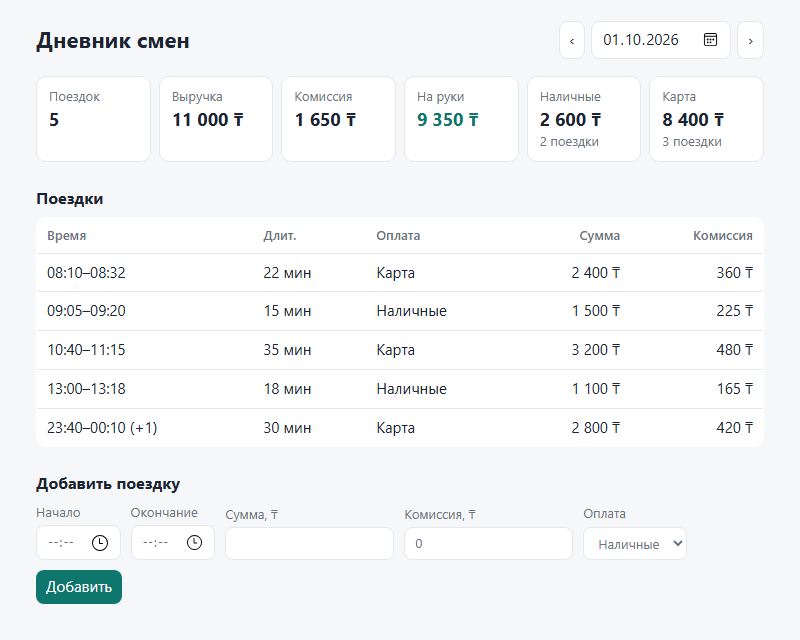

# Дневник смен водителя

Небольшое веб-приложение: сервер на **FastAPI** хранит поездки водителя в JSON-файле и отдаёт по API поездки и сводку за день; клиент — одна HTML-страница без сборки (чистый JS), её раздаёт тот же сервер.



## Как запустить

Нужен Python 3.11+.

```bash
python -m venv .venv
# Windows:  .venv\Scripts\activate
# Linux/macOS:  source .venv/bin/activate
pip install -r requirements.txt

uvicorn app.main:app --reload
```

Откройте http://localhost:8000 — клиент; http://localhost:8000/docs — интерактивная документация API (Swagger).

Тесты:

```bash
pytest
```

Настройки через переменные окружения:

| Переменная | По умолчанию | Что это |
|---|---|---|
| `TRIPS_FILE` | `data/trips.json` | файл с поездками |
| `DRIVER_TZ_OFFSET` | `5` | часовой пояс водителя (часы от UTC), по нему поездки делятся на дни |

## Что сделано

**API**

| Метод | Путь | Что делает |
|---|---|---|
| `GET` | `/api/days` | список дней, в которые были поездки |
| `GET` | `/api/days/{YYYY-MM-DD}` | сводка и список поездок за день одним ответом (его использует клиент) |
| `GET` | `/api/trips?date=YYYY-MM-DD` | только поездки за день |
| `GET` | `/api/summary?date=YYYY-MM-DD` | только сводка за день |
| `POST` | `/api/trips` | добавить поездку |

Сводка: число поездок, выручка, комиссия, «на руки» (выручка − комиссия), разбивка наличные/карта (количество и сумма).

```json
{"trips_count": 2, "revenue": 3900, "commission": 585, "net": 3315,
 "cash": {"count": 1, "amount": 1500}, "card": {"count": 1, "amount": 2400}}
```

**Проверка данных при добавлении** (ошибка → `422`, в файл ничего не пишется):
- сумма > 0, целое число тенге;
- окончание строго позже начала;
- время обязательно с часовым поясом (`+05:00` или `Z`);
- способ оплаты — `cash` или `card`;
- комиссия ≥ 0 и не больше суммы.

**Защита от дублей** — `POST /api/trips` идемпотентен:
- `201` — поездка создана;
- `200` — такая поездка уже есть, возвращается сохранённая, дубль не создаётся. Дублем считается тот же `id` с теми же данными, **или** те же данные (начало, окончание, сумма, оплата, комиссия) под другим/пустым `id`. Время сравнивается как момент, поэтому `08:10+05:00` и `03:10Z` — одно и то же;
- `409` — `id` уже занят поездкой с другими данными (не перезаписываем молча);
- `id` можно не передавать — сервер выведет его из содержимого поездки, так что повтор без `id` получит тот же `id`.

Проверка и запись идут под одной блокировкой, а файл пишется атомарно (временный файл + `os.replace`), поэтому одновременные повторы тоже дают ровно одну запись.

**Клиент**: сводка карточками, таблица поездок, переключение дней (‹ ›, календарь, день сохраняется в URL `#2026-10-01`), форма добавления поездки с выводом ошибок сервера. Если время окончания меньше времени начала, форма считает, что поездка закончилась после полуночи.

**Решения, которые стоит знать**
- День поездки — дата её **начала** в часовом поясе водителя. Поездка 23:40–00:10 относится к дню начала (в таблице помечена `(+1)`).
- Деньги — целые тенге (`int`), чтобы не было ошибок округления float.
- Хранилище — JSON-файл, как в задании. Для одного водителя этого достаточно; для многих пользователей стоило бы взять SQLite/Postgres с уникальным индексом.

**Тесты** (`tests/`, 30 штук):
- `test_summary.py` — расчёт сводки (пример из задания, пустой день, наличные+карта = выручка), отнесение поездки к дню по часовому поясу и через полночь;
- `test_api.py` — эндпоинты, все правила валидации, дубли: повтор с тем же `id`, без `id`, под другим `id`, в другом часовом поясе, конфликт `id`, повтор после «перезапуска» сервера, 8 одновременных повторов → одна запись.

## Структура

```
app/models.py    — модели и валидация (Pydantic)
app/summary.py   — расчёт сводки и отбор поездок за день
app/storage.py   — JSON-хранилище и идемпотентное добавление
app/main.py      — FastAPI-приложение
static/          — клиент (HTML/CSS/JS)
data/trips.json  — пример данных
tests/           — pytest
```

## Как использовался ИИ

<!-- Черновик: перепишите своими словами по своему опыту. -->

Код написан вместе с Claude Code (ИИ-агентом в терминале): я ставил задачу и решения по поведению, ИИ писал код, тесты и README, я проверял результат, запускал тесты и смотрел клиент в браузере.

Где ИИ ошибся или что пришлось поправить:
- в клиенте сначала было «2 поездок» — исправлено на правильное склонение через `Intl.PluralRules`;
- в JS часовой пояс `+5` был захардкожен в двух местах, плюс осталась неиспользуемая функция — вынесено в одну константу;
- нужно было явно решить пограничные случаи, которые в задании не описаны: к какому дню относится поездка через полночь, что делать при повторе того же `id` с другими данными (выбран `409`, а не перезапись), считать ли дублем ту же поездку под другим `id` (да).
